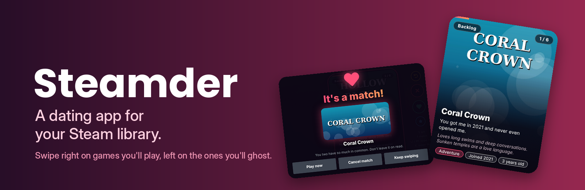
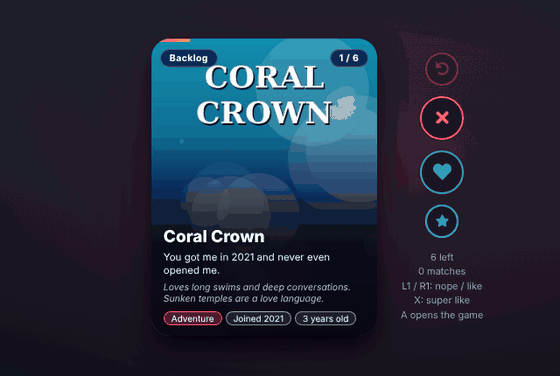
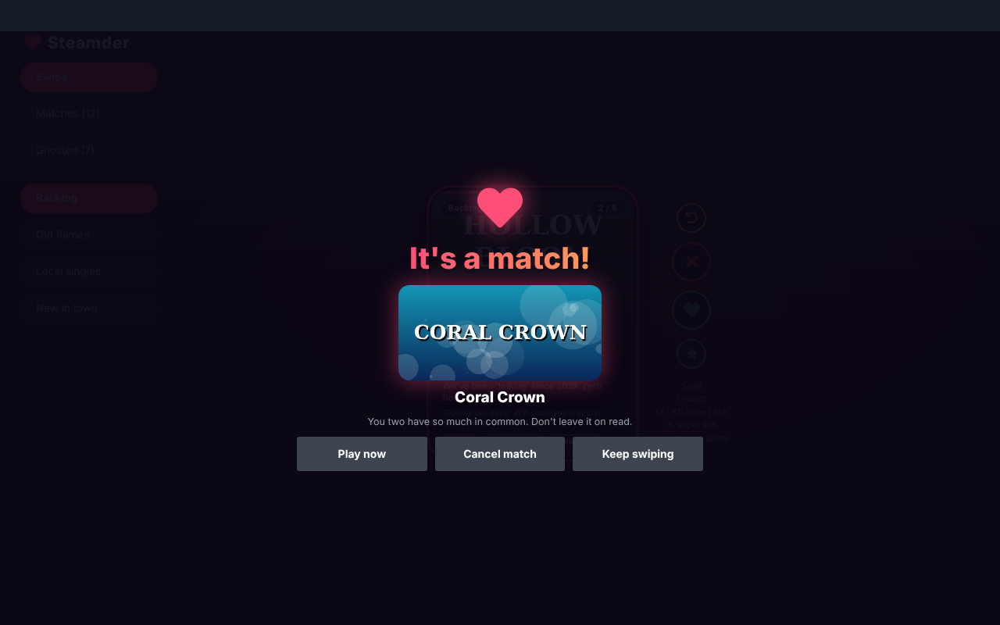
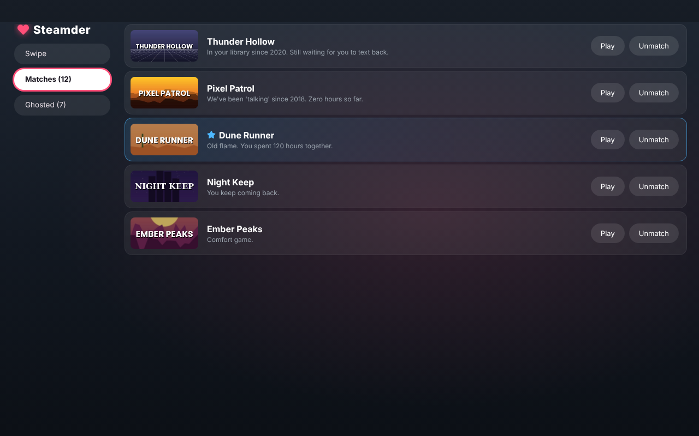
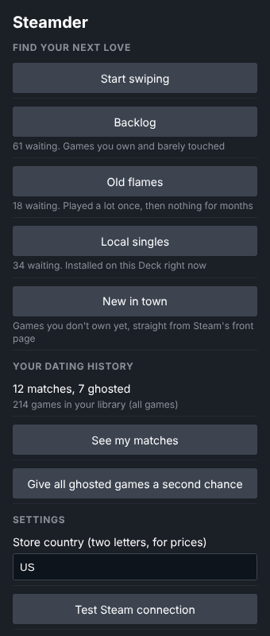

<p align="center">
  
</p>

<p align="center">
  <a href="../../releases/latest"></a>
  
  
  
</p>

<p align="center">
  <b>A dating app for your Steam library.</b><br>
  Swipe right on games you want to play, left on the ones you'll ghost.<br>
  No keys, no accounts, no build step: download the zip and install.
</p>

<p align="center">
  
</p>

---

## ✨ Features

|  |  |
|---|---|
| 👉 **Swipe** | Drag cards with your finger, use L1 / R1 (or L2 / R2), or the round buttons. Up on the D-pad or X is a super like. |
| 🃏 **Four decks** | **Backlog** (barely played), **Old flames** (played a lot, then nothing for 90+ days), **Local singles** (installed right now), **New in town** (games you don't own, from Steam's front page lists). |
| 💘 **It's a match!** | Like a game and it might like you back, with *Play now* (or *Open store page* for games you don't own). |
| 📝 **Silly bios** | Every game gets a bio built from real data: your playtime, when you bought it, its age, genres and description. |
| 💔 **Matches and Ghosted** | Lists with unmatch and second chance. **Rewind** takes back your last swipe. |
| 🔓 **No keys or accounts** | Game details come from Steam's public store, one request every ~1.6 s in the background, cached for 60 days. |

<p align="center">
  
  
</p>

## 📥 Install

> Requires [Decky Loader](https://decky.xyz) on your Steam Deck.

### Option A: from the release zip (recommended)

1. Go to the [**latest release**](../../releases/latest) and copy the link of `Steamder-vX.Y.Z.zip`.
2. On the Deck, open **Decky settings → General** and turn on **Developer mode**.
3. Open **Decky settings → Developer → Third-Party Plugins → Install Plugin from URL**, paste the link and press **Install**.

You can also download the zip in Desktop Mode and use **Install Plugin from ZIP File** on the same page.

### Option B: by hand (Konsole, Desktop Mode)

```bash
cd ~/Downloads
unzip Steamder-v*.zip
sudo rm -rf ~/homebrew/plugins/steamder
sudo cp -r steamder ~/homebrew/plugins/
sudo systemctl restart plugin_loader
```

### Updating

Install the new zip the same way, over the old one. The plugin keeps its name and folder (`steamder`), so Decky replaces it in place. Your matches, ghosted games and cached details live in `~/homebrew/settings/steamder` and are kept.

## 🕹️ Use



Open the **Quick Access menu (•••) → Steamder** and press **Start swiping** or one of the decks.

- **L1 / R1 or L2 / R2**: nope / like, anywhere on the swipe page.
- **X**: super like. **Y**: rewind.
- **D-pad** on the card: left goes to the side menu, right or down goes to the round buttons, up is a super like.
- **A** on the card opens the game.
- After a match, the match screen selects *Keep swiping* and focus returns to the Like button. In the lists, focus moves to the next row after an unmatch.

| Setting | What it does |
|---|---|
| Store country | Two letters, for prices in *New in town*. |
| Give all ghosted games a second chance | Empties the Ghosted list. |
| Test Steam connection | Checks Steam's store, if *New in town* stays empty. |

<br clear="right">

## 🩺 Good to know

- Data: `settings.json` (matches, ghosted, country), `details.json` and `library.json` in `~/homebrew/settings/steamder`.
- Use *Test Steam connection* in the panel if "New in town" stays empty.
- Log: `tail -n 30 ~/homebrew/logs/steamder/*.log`

## 🛠️ Building from source

You don't need this to use the plugin; the release zip is ready to install.

```bash
npm install
npm run typecheck
npm run build      # dist/index.js
npm run package    # release/Steamder-vX.Y.Z.zip
```

Pushing a tag like `v1.4.2` (or `1.4.2`) runs the GitHub Actions workflow, which builds the zip and attaches it to a GitHub release. The tag must match the version in `package.json`.

```
src/index.tsx   Quick Access panel and the swipe page
main.py         Python part: library sync, Steam store details, bios, matches
tools/          build script and the Decky globals it uses
```

## 📄 License and credits

BSD-3-Clause © SANSO. See [LICENSE](LICENSE) and [CHANGELOG](CHANGELOG.md).

Game details and prices from the Steam store. Not affiliated with Valve or Tinder. The games in these screenshots are made up for the demo.
